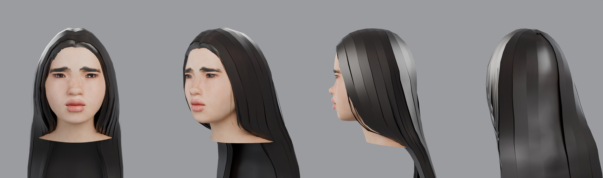
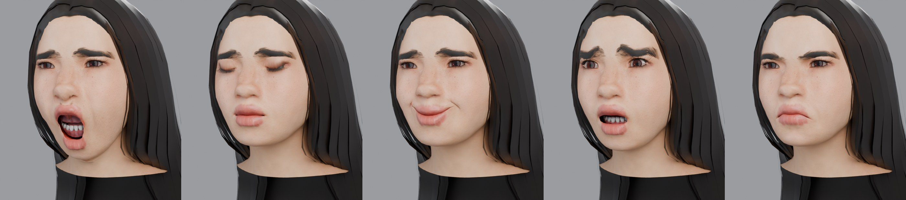
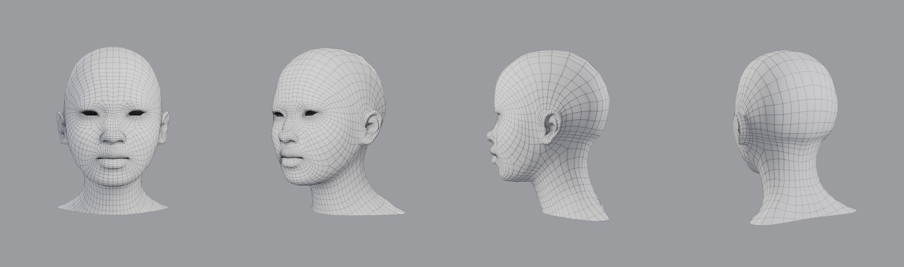

# head-modeling

Скилл для Claude: моделирование и разбор 3D-головы. Принципы формы и топологии лица, студийный пайплайн (скульпт → ретопология → UV → запекание → текстуры → мимика → LOD), сборка game-ready головы в Blender по референсу и проверка чужой модели по чек-листу.



## Что делает

1. **Разбор** — объясняет, как головы делают в студиях: анатомия и пропорции, скульптинг, петли вокруг глаз и рта, бюджеты полигонов, мимика (FACS / ARKit), LOD.
2. **Проверка** — проходит чужую или свою голову по чек-листу: топология, UV, текстуры, шейпы, экспорт.
3. **Сборка** — собирает game-ready голову скриптами в headless Blender. По умолчанию на базовом меше MakeHuman (CC0), подгоняя форму под референс весами морфов; запасной путь — с нуля скриптом.
4. **Честность** — заранее говорит, чего скрипт не даёт: портретное сходство и живая мимика остаются работой художника.

## Пример

[`examples/v2`](examples/v2) — голова, собранная этим пайплайном по трём скриншотам персонажа:

| | |
|---|---|
| LOD0 / LOD1 / LOD2 | 17 416 / 8 459 / 3 139 треугольников |
| Состав | голова, глаза, зубы, язык, ресницы, брови, волосы |
| Мимика | 20 шейпов с именами ARKit; зубы и язык двигаются жёстко с челюстью |
| Текстуры | BaseColor, Normal (OpenGL), ORM 2048² |
| Проверка | обратный импорт GLB: 0 вырожденных граней, 0 non-manifold, UV без наложений |




Оценка независимого критика: техника — уровень начинающего техартиста, арт — базовый меш с подкрученными слайдерами, портретного сходства нет. Ограничения метода описаны в `SKILL.md` (раздел «Чего этот метод не даёт»); скриншоты-референсы в репозиторий не входят.

## Установка

- **Claude (claude.ai):** загрузи `SKILL.md` как скилл.
- **Claude Code:** скопируй папку в `~/.claude/skills/head-modeling/`.

## Скрипты

```bash
pip install bpy numpy scipy pillow   # bpy = Blender как модуль Python (5.x)

./scripts/fetch_makehuman.sh     # базовый меш и морфы MakeHuman + набор ассетов CC0 в ./vendor (~300 МБ)
./scripts/run_all.sh             # сборка целиком, ~7 минут на CPU; результат в ./build/out
python3 scripts/60_compare.py front.png profile.png three_quarter.png   # лист «референс сверху, модель снизу»
```

| Скрипт | Что делает |
|---|---|
| `10_build.py` | форма из морфов по `config.json`, прокси (глаза, зубы, язык, ресницы, брови, волосы), мимика, срез шеи |
| `20_textures.py` | переупаковка UV в атлас 2048, запекание AO, BaseColor / Normal / ORM, текстуры прокси |
| `30_finish.py` | материалы, LOD с переносом шейпов, экспорт GLB / FBX / .blend, превью |
| `40_verify.py` | обратный импорт GLB и замеры → `verification.json`, развёртка |
| `50_wire.py` | лист с сеткой исходной квадовой головы |
| `config.json` | веса морфов, кожа, волосы, брови, оттенки — здесь подгоняется лицо под референс |

Пути переопределяются переменными окружения: `HEAD_ROOT` (куда писать), `MH_DATA`, `MH_PACK` (данные MakeHuman), `HEAD_CONFIG`.

## Лицензии

Базовый меш, морфы и ассеты MakeHuman опубликованы проектом под CC0 и в репозиторий не входят — их скачивает `fetch_makehuman.sh`.
