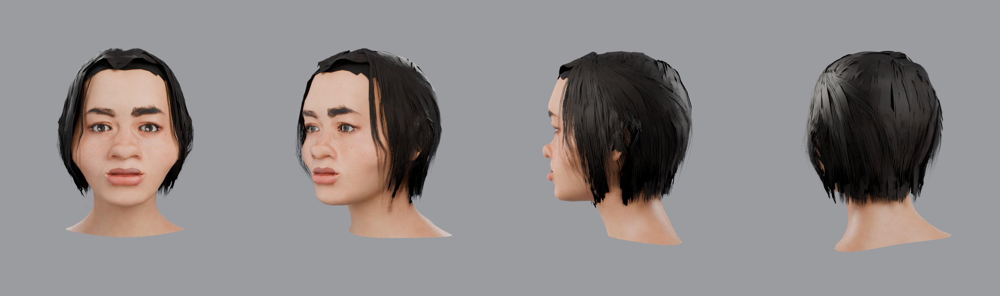
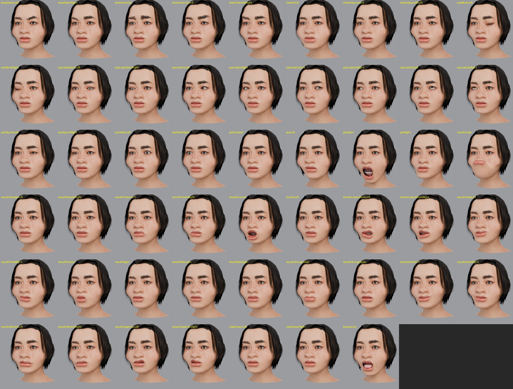
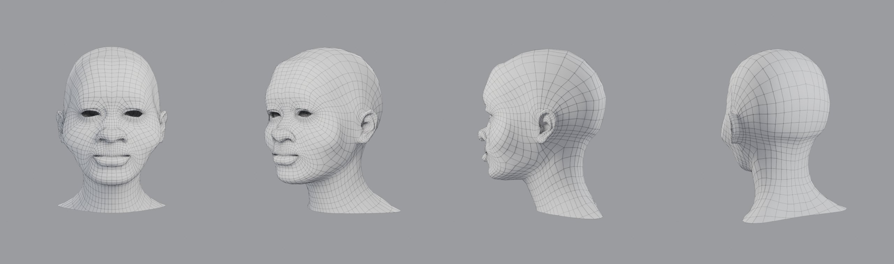

# head-modeling

Скилл для Claude: моделирование и разбор 3D-головы. Принципы формы и топологии лица, студийный пайплайн (скульпт → ретопология → UV → запекание → текстуры → мимика → LOD), сборка game-ready головы в Blender по референсу и проверка чужой модели по чек-листу.



## Что делает

1. **Разбор.** Объясняет, как головы делают в студиях: анатомия, скульпт, петли вокруг глаз и рта, бюджеты, мимика (FACS / ARKit), LOD.
2. **Проверка.** Проходит чужую или свою голову по чек-листу: топология, UV, текстуры, шейпы, риг, экспорт.
3. **Сборка.** Собирает голову скриптами в headless Blender на базовом меше MakeHuman (CC0):
   - форма подгоняется под три скриншота по 478 точкам MediaPipe;
   - волосы — грум из процедурных карт прядей;
   - мимика — 52 формы ARKit;
   - скелет, три LOD, экспорт в GLB и FBX;
   - автоматические проверки.
4. **Честность.** Заранее говорит, чего скрипт не даёт: портретное сходство и живая мимика остаются работой художника.

## Пример

[`examples/v6`](examples/v6) — голова, собранная этим пайплайном по трём скриншотам персонажа (сами скриншоты в репозиторий не входят).

| | |
|---|---|
| LOD0 / LOD1 / LOD2 | 26 872 / 13 186 / 5 516 треугольников |
| Состав | голова, глаза, зубы, язык, ресницы, брови, шапка волос и около 370 карт прядей |
| Мимика | все 52 формы ARKit; правые — зеркало левых; зубы и язык двигаются жёстко с челюстью |
| Риг | `root > neck > head > eye_L / eye_R` |
| Текстуры | BaseColor, Normal (OpenGL), ORM 2048²; лицо отделено от затылка и ушей в UV |
| Проверки | обратный импорт GLB; видимость зубов лучами с 8 камер в 17 позах; симметрия; отступ ресниц и бровей; центр вращения глаз; заломы граней в 56 позах |




Четыре круга независимых критиков (каждый раз новый, без доступа к прошлым версиям): арт 3/10 во всех кругах, техника 5 → 6/10. Сходство и волосы держат оценку внизу: морфы MakeHuman и процедурные карты дают типаж, но не портрет. Ограничения перечислены в `SKILL.md`.

## Установка

- **Claude (claude.ai):** загрузи `SKILL.md` как скилл.
- **Claude Code:** скопируй папку в `~/.claude/skills/head-modeling/`.

## Скрипты

```bash
pip install bpy numpy scipy pillow mediapipe opencv-python-headless   # bpy = Blender как модуль Python (5.x)

./scripts/fetch_makehuman.sh   # MakeHuman (меш, морфы), ассеты CC0 и модель MediaPipe в ./vendor
./scripts/run_all.sh           # сборка по scripts/config.json → ./build/out

# подгонка формы под свои скриншоты: refs/front.png, refs/right.png (профиль, нос вправо), refs/left.png
./scripts/fit_all.sh           # → build/fit/w_final.json: перенеси targets в config.json и пересобери
python3 scripts/fit/variants.py scripts/config.json build/fit/cams.json front variants.json 0.3,0.1,0.7,0.6 out.jpg   # A/B правки по глазу
python3 scripts/fit/compare_final.py build/out/head_source.blend build/fit/cams.json compare.png                        # референс vs модель
```

| Скрипт | Что делает |
|---|---|
| `10_build.py` | форма из морфов, прокси (глаза, зубы, язык, ресницы, брови), грум волос, 52 формы ARKit, сглаживание и зеркалирование форм, срез шеи |
| `20_textures.py` | разрезка острова лица, атлас 2048, запекание, BaseColor / Normal / ORM, текстуры прядей и глаз |
| `30_finish.py` | материалы, скелет и веса, LOD с переносом форм, экспорт GLB / FBX / .blend, превью |
| `40_verify.py` | обратный импорт GLB → `verification.json` |
| `45_checks.py` | зубы при закрытом рте, центр вращения глаз, лист всех 52 форм → `checks.json` |
| `46_folds.py` | заломы граней в каждой форме и в комбинациях для липсинка → `folds.json` |
| `fit/` | подгонка по точкам: детектор (`lm.py`), маски кожи, рендер модели с камерами референса, решатель (`fit.py`), A/B-варианты, сравнение |

Пути переопределяются переменными окружения: `HEAD_ROOT`, `MH_DATA`, `MH_PACK`, `MP_MODEL`, `HEAD_CONFIG`, `REF_FRONT`, `REF_RIGHT`, `REF_LEFT`. Если анфас-скриншот снят не в 2× разрешении, поправь масштаб анфаса (`0.5`) в начале `fit/fit.py`.

## Лицензии

Базовый меш, морфы и ассеты MakeHuman опубликованы проектом под CC0 и в репозиторий не входят; их скачивает `fetch_makehuman.sh`. Модель MediaPipe Face Landmarker распространяется Google под своей лицензией и тоже скачивается отдельно.
